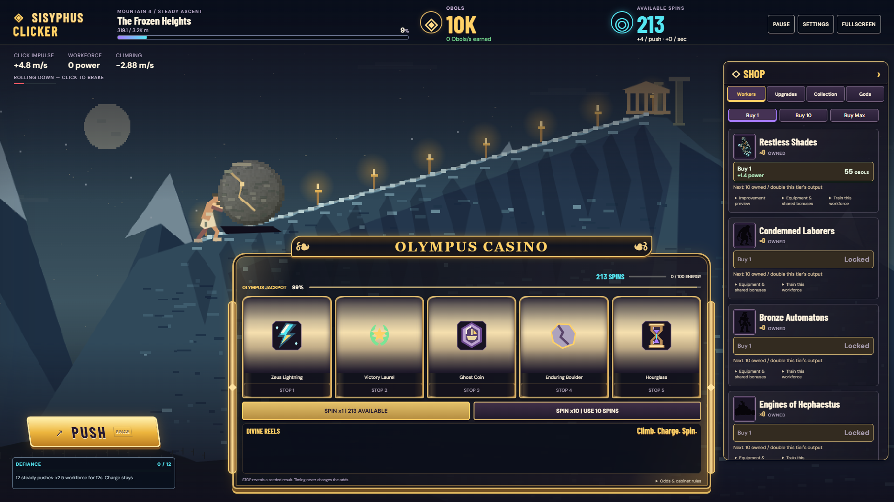

# Sisyphus Clicker

Pixel-art boulder-pushing game with persistent progression and a Windows desktop edition built with JavaScript and Electron.

## Overview

An atmospheric pixel-art game about an endless task. Push a giant boulder up a moonlit mountain, reach the summit, watch the stone return, and begin again. The original canvas graphics and lifetime counters remain intact. The progression update adds an Obol economy, four worker tiers, harder mountains, offline work, collectibles and optional prestige.

## Features

- Push the boulder with mouse, keyboard, or the on-screen control.
- Earn Obols, hire workers, and purchase upgrades in the current source version.
- Climb increasingly difficult mountains across five distinct pixel-art environments.
- Unlock optional prestige after 28 completed climbs per run, with visible progress and confirmation.
- See original worker and upgrade artwork, evolving equipment, and in-game collectible previews.
- Save progression locally and export or import saves.
- Earn up to 8 hours of offline workforce progress using the same economy as live play.

## Screenshots



UI preview regenerated from the current source build at 1280 x 800, with dialogs closed. Captured in Chrome using the bundled layout, fonts, artwork and canvas renderer.

## Technologies

JavaScript, Canvas, Vite, Electron, electron-builder, browser local storage, and the Node.js test runner.

## Getting Started

Download the [Windows x64 version 1.2.2 release](https://github.com/scryingorb/sisyphus-clicker/releases/tag/v1.2.2). This release includes the worker artwork, progression and mountain-balance updates.

Windows 10/11, x64. No Node.js, VS Code, terminal, server or internet connection is needed to play.

- Install: run `release/Sisyphus-Clicker-Setup-1.2.2.exe`. The installer allows a per-user installation directory and creates Start menu/desktop shortcuts.
- Portable: run `release/Sisyphus-Clicker-Portable-1.2.2.exe` directly. It extracts the bundled runtime temporarily; first launch may take a few seconds. It does not install the game.
- Unpacked: run `release/win-unpacked/Sisyphus Clicker.exe`. Keep the entire `win-unpacked` folder together, including its DLLs and resources.

The published installer and portable EXE are unsigned and have no auto-update. To update, download and run the new installer; the per-user save directory stays the same. The `release/` paths also identify local packaging outputs. Windows may show an unknown-publisher warning. Uninstalling keeps saves. The installer and portable application use the same per-user save directory.

### Build or run from source

Use Node.js 22.12+ or 24 on Windows. Run from the project directory:

```powershell
npm.cmd ci
# Explicitly ensures the runtime is present even when npm lifecycle scripts are restricted:
node node_modules/electron/install.js
npm.cmd test
npm.cmd run desktop
```

`desktop` builds the web assets and opens Electron without a separate server.

Build the installer and portable executable:

```powershell
npm.cmd run package:win
```

Outputs go to `release/`. This script uses the installed local Electron runtime, creates the icon, bundles the game/fonts locally, and specifies `--publish never`. Initial dependency/tool downloads need internet access; playing the result does not. For only the unpacked executable:

```powershell
npm.cmd run package:dir
```

For the browser version:

```powershell
npm.cmd run dev
npm.cmd run build
npm.cmd run preview
```

## Usage

Choose **Begin ascent**, then click the hill, press **PUSH**, or press **Space**. Pushes add momentum and charge Defiance. Inputs are limited to eight accepted pushes per second. Gravity, drag and signed velocity still communicate the stone's weight; falls only cost height.

The right-hand ledger contains workers, ordinary upgrades, the collection and the Gods tab. On narrow screens it moves below the climb. Earn Obols for each new highest metre on the current mountain and receive a summit bonus. Repeated falls and recrossing paid height do not earn more currency. The displayed income is workforce earnings at steady speed on new ground, excluding summit bonuses.

- **Workers:** Restless Shades, Condemned Laborers, Bronze Automatons and Engines of Hephaestus. New runs unlock at 0, 4, 10 and 17 run summits. Buy 1, 10 or Max; each copy raises the next price. Every tier doubles its output at 10, 25, 50 and 100 owned. Workers support the weight and pull toward a bounded uphill speed, so automation needs no clicks to remain productive.
- **Upgrades:** manual impulse, rollback resistance, global workforce output and four tier-specific training upgrades. Training adds 50% per level (10 levels); its factor multiplies ownership milestones and other bonuses. Every 10 Laborers adds 35% Shade output; every 5 Automatons adds 60% Laborer output; every 3 Engines adds 50% Automaton output. Each link is additive internally and multiplicative with other factors. The chain runs from stronger tiers to weaker tiers, with no circular dependencies. Shop previews use the same production calculations as actual purchases, including cross-tier effects and crossed milestones.
- **Mountains:** five repeating environments with distinct scenery, ground materials, resistance and gravity. The opening distances are 235, 400, 1,300, 4,000 and 7,500 metres, followed by a growing curve that keeps each mountain harder for the same workforce. Environmental penalties ramp through mountain 13. A short summit return automatically starts the next mountain and preserves purchases. The goal panel previews summit rewards, unlocks and the next environment. Height rewards vary by mountain; the summit bonus is `24 * (1 + 0.35*n + 0.06*n^3)` before divine earnings bonuses, where `n` is completed climbs this run. See [the balance report](docs/balance.md) for the full curve and measured timings.
- **Defy the Gods:** after 28 run summits, optionally reset the ordinary economy for `floor(8 * (run summits / 28)^1.5)` Divine Favor. Tier training resets too; equipment and cross-tier factors derive from current ownership. A confirmation lists every reset and preserved category. The first 8 Favor can buy +40% workforce and +20% earnings. Previously eligible saves retain their earned 15-summit threshold for that run. An immediate second reset awards nothing.
- **Visible workforce:** at most four representatives reuse the original transparent shop portraits. Slope-mounted terraces, ropes and hauling equipment evolve at 10 and 25 owned, matching the production milestones. Gear animation uses the session clock and freezes with pause or reduced motion. Rendering never modifies gameplay state.
- **Defiance:** 12 accepted pushes trigger 12 seconds at 2.5x workforce output (plus permanent bonuses). The 60-second cooldown begins at activation, so recovery lasts 48 seconds after the boost. Charge never decays. Pushes during recovery still add momentum but cannot charge or extend the boost. With workers, individual impulses are 20% of their manual-only strength, keeping bursts helpful while purchases drive most progress.
- **Collection:** six purely visual boulders/outfits, four replayable story discoveries and three lifetime achievements. Requirements remain visible while locked.
- **P / Esc:** pause. Focus loss, minimization and system sleep also pause the live simulation. Resume settles the time away; workers can complete mountains while away for up to 8 hours. A single summary reports time, earnings, summits and unlocks. No automatic purchases or prestige.
- **Settings:** mute, volume, reduced motion, save import/export and confirmed full reset. F11 toggles fullscreen.

## Saves and compatibility

The storage key remains `sysyphus-clicker-v1`. Schema 5 preserves purchases, currency, training, Divine Favor, collectibles and records. Old unbought worker unlocks are derived from the former 0/1/3/5 thresholds; owned tiers remain usable regardless of threshold. Already-earned prestige eligibility remains available for the current run. Previously earned cosmetic and story unlocks are retained, including unequipped collectibles whose new thresholds are higher. After intentional prestige, the new thresholds apply. Legacy counters and fractional height migrate intact; paid height cannot generate duplicate rewards. See [balance and migration details](docs/balance.md).

All progression, selections, lifetime records, settings and settlement timestamps persist. Loads validate finite numbers and bounded arrays, restore the boulder at rest, and recover interrupted summit returns without double rewards. Malformed saves fall back to a playable state. Export/import remains available; importing intentionally replaces the current state and starts a fresh offline timestamp.

Defiance charge, boost time and cooldown are saved. Live pause freezes all simulation and workforce animation; normal Resume settles elapsed paused/away time as offline work, consuming only the remaining boost and cooldown. Summit returns consume timers without resetting or refreshing them. Offline work never creates clicks or a new boost. The prestige confirmation itself freezes simulation until resolved.

Offline settlement runs the same resistance and reward rules in bounded 50 ms steps (at most 576,000 steps). Live physics uses 1/240-second steps. Offline settlement commits before rewards are exposed; failed writes do not award offline progress. The saved timestamp never moves backward. Local saves cannot prevent deliberate save-file editing or system-clock manipulation; ordinary repeated loading cannot claim the same elapsed time twice.

Desktop saves remain under `%APPDATA%\Sisyphus Clicker\Local Storage`. Browser saves remain tied to their origin. Version 1.2.2 packages these changes into the installer and portable downloads.

## Validation

```powershell
npm.cmd test
npm.cmd run test:desktop
npm.cmd run test:portable
```

Desktop tests require a local Windows build. They use separate temporary profiles under `test-results/` and preserve the player's real saves. The portable test uses a loopback debugging connection only for automation. Reports and screenshots are written under `test-results/`; they are not packaged.

The focused tests cover acceleration, multi-click braking, normal/slow/fast clicking, bottom/summit limits, 30/60/120/144 FPS, capped stalls, position-based rotation and character alignment, pause/resume, summit pause and recovery, resets, save compatibility and exact counters. Desktop automation checks offline loading, input, minimize/focus pause, settings, save transfer/relaunch, restart confirmation, fullscreen and 800 × 620 layout.

The current source passes 46 unit tests, pacing assertions, the production build and four browser smoke suites. The [version 1.2.2 release workflow](https://github.com/scryingorb/sisyphus-clicker/actions/runs/39389235147) passed both the packaged Windows game and portable launcher checks offline before publishing. Installing through the setup wizard itself is not tested. Validation reports and screenshots are available in the release workflow artifacts.

## Physics tuning and architecture

`src/physics.js` groups the original standalone physics constants. The progression game supplies its 4.8 manual impulse through `BALANCE` in `src/progression.js`; the table below describes the underlying standalone physics defaults. Distance is measured in hill-progress units (100 units per climb), speed in units/second, gravity in units/second squared, and drag per second.

| Setting | Default |
| --- | --- |
| CLICK_FORCE | 2 |
| DOWNHILL_GRAVITY | 4 |
| FRICTION | 0.35 |
| MAX_UPHILL_SPEED | 12 |
| MAX_DOWNHILL_SPEED | 8 |
| ROLLBACK_DELAY | 0.35 seconds |
| MAX_FRAME_DELTA | 0.05 seconds |

`src/session.js` advances the entire game with a 1/240-second fixed timestep. Long stalls are capped rather than caught up. Gravity gradually builds after a push; clicks add force to the existing velocity and never assign a direction.

- `src/state.js`: schema migration, validation, counters and summit completion.
- `src/progression.js`: central economy, environment, collection and prestige configuration/calculations.
- `src/simulation.js`: shared live/offline movement, reward accounting and persistent settlement.
- `src/progression-ui.js`: ledger, collection and prestige confirmation.
- `src/main.js`: input, HUD, pause/settings dialogs and save transfer.
- `src/workforce-scene.js`: four bounded slope stations and procedural equipment, reusing the preserved worker portraits.
- `src/scene.js`: original responsive pixel-art renderer, distance-based rotation/gait and effects.
- `src/scene-environments.js`: distinct pixel scenery and materials for the five environments.
- `src/mountain-goals.js`: read-only goal and summit-reward previews.
- `src/audio.js`: locally synthesized sounds and volume/mute.
- `desktop/main.cjs`, `desktop/preload.cjs`: Electron window, per-user profile, offline restrictions and limited fullscreen/pause bridge.
- `electron-builder.json`: Windows NSIS installer and portable packaging.
- `scripts/generate-icon.mjs`: original procedural PNG/ICO game icon.
- `src/assets/`: bundled original fonts and their SIL Open Font licenses.

Electron uses a sandboxed renderer, context isolation and no renderer Node integration. The production page blocks network connections, and the desktop wrapper rejects remote requests and navigation. Packaging follows the [Electron security guide](https://www.electronjs.org/docs/latest/tutorial/security) and [electron-builder Windows configuration](https://www.electron.build/win/).

## Progression validation and longer balance

Prestige is optional after **28 completed climbs in the current run**, with 8 Favor at the threshold. Ordinary summits advance the mountain and keep purchases; they do not prestige. The Gods tab shows the remaining climb requirement and requires explicit confirmation. An old save with already-earned 15-climb eligibility retains it for its current run only.

The first five relaxed-play climbs measure about 46s, 1m13s, 2m30s, 4m56s and 5m14s individually. Each mountain requires more work from the same workforce; upgrades can still make a later clear quicker. Simulations estimate 2:25:40 for steady 1 click/s, 2:46:37 for occasional bursts, 3:09:55 for automation after manual recruitment, and 1:37:04 for a second burst run after spending 8 Favor. Opening upgrade: 15 seconds; first Shade: 45 seconds. Offline earnings remain capped at **8 hours**.

[Full balance report](docs/balance.md) documents before/after results, first-five individual/cumulative times, purchasing assumptions, unlocks, longest purchase gaps, isolated workers, migration and early/middle/late offline results. These are simulation estimates, not human playtests.

Run `npm.cmd test`, `node scripts/progression-sim.mjs`, and `npm.cmd run build -- --configLoader native`. Then run `node scripts/progression-smoke.mjs`, `node scripts/workforce-smoke.mjs`, `node scripts/ui-smoke.mjs` and `node scripts/mountain-smoke.mjs`. Browser suites use installed Chrome with isolated profiles and built assets at 1280x800, 800x620 and 390x844. Reports and screenshots are under `test-results`; the canonical pacing report is `mountains-after.json`.

Current verification: all 46 unit tests, pacing assertions, production build and four browser suites pass. Native release checks run on GitHub's Windows runner; the local runtime ACL limitation is described below.

## UI and purchase artwork update

The compact ascent HUD, adjacent PUSH/Defiance controls, tabbed shop, expandable explanations, collection, prestige and offline summary share charcoal/bronze styling. The scene remains the primary desktop area; mobile places the shop below the scene. Notifications occupy a dedicated shop row, keeping the boulder and crews clear.

All 11 ordinary, tier and permanent upgrades have original generated transparent pixel artwork. The four worker portraits are preserved. Six collection previews use the actual in-game renderer. See `src/assets/items/README.md` for the complete definition mapping and generation provenance. These assets, fonts and synthesized sounds work without remote requests.

Purchase feedback is emitted after the purchase is saved, once per bulk transaction. Milestone messages report the actual production change and ownership bonus; equipment changes highlight the relevant scene station. Defiance activation/expiration, completed summits and prestige have distinct short cues. Notifications consolidate rapid repeats and cap the queue at four. Scene celebrations cap at four groups of twelve glints; audio caps at six cue voices. Pause freezes the scene/notification clock, mute stops voices, and reduced motion uses static emphasis. Loading/importing does not reconstruct historical feedback, and offline gains are summarized.

Validation: 46 unit tests, the production build (`npm.cmd run build -- --configLoader native`), progression/workforce smoke suites and `node scripts/ui-smoke.mjs` passed. The UI suite checks every loadable purchase image, transparency, six cosmetic previews, locked/unaffordable states, bulk milestones, Defiance activation/expiry, summit save/reload, prestige confirmation and offline summary. Desktop 1280x800, compact 800x620 and mobile 390x844 screenshots were inspected; large currency and equipment stages were included. The accompanying longer balance revision is measured separately in `docs/balance.md`; UI feedback does not grant rewards or modify purchase calculations.

Local source Electron was attempted again on 2026-10-18 and remains unverified: `FATAL:electron\shell\browser\win\install_dir_access.cc:52` reports that `node_modules\electron\dist` has an AppContainer package SID ACL entry but lacks `ALL APPLICATION PACKAGES`, so Windows denies the sandbox token access. No permissions or sandbox settings were altered. The GitHub Windows runner independently validated the packaged executable and portable launcher for version 1.2.2. Manual audio listening and installation through the setup wizard remain unverified.

## Project Status

Released: Windows version 1.2.2, including progression, artwork and mountain-balance updates. Download the installer or portable executable from the release above. Updates are manual; existing installations do not auto-update.
